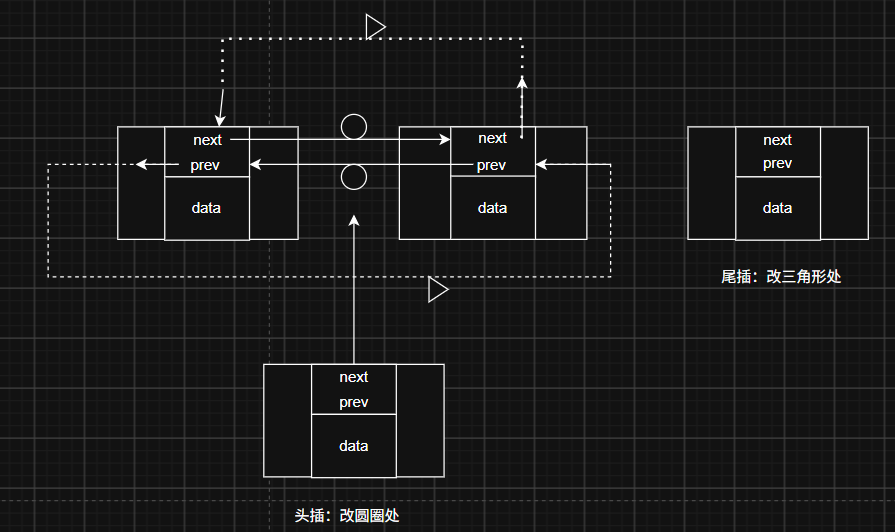

# 内核对象分布：RT-Thread 怎么用一个数组管住所有内核对象

> 环境：RT-Thread 4.0.3（源码 `src/object.c`、`include/rtdef.h`）
> 文中代码均取自本工程实际使用的内核源码，不是照抄手册。

## 目录

- [先看结论](#overview)
- [Step 1 对象容器：每类对象一个"登记处"](#step1)
  - [① rt_object_information 的三个成员](#step1-1)
  - [② 容器数组 rt_object_container](#step1-2)
  - [③ 索引枚举：必须和数组同序](#step1-3)
- [Step 2 对象是怎么挂进链表的](#step2)
  - [① 侵入式链表节点](#step2-1)
  - [② 所有对象的开头都是 rt_object](#step2-2)
  - [③ 类型 → 容器：rt_object_get_information](#step2-3)
- [Step 3 从链表节点反推对象：container_of](#step3)
- [一张图：头插和尾插改的是哪几个指针](#figure)
- [总结：四个容易记错的点](#summary)
- [怎么自己验证](#verify)
- [附录：动手用 60 行复刻 rt_list 的核心](#appendix)

---

内核里要管理的东西很多：线程、信号量、互斥量、事件、邮箱、消息队列、内存堆、内存池、设备、定时器、模块……它们的共同需求是：**按类型管理、按名字查找、能遍历、能统计**。

RT-Thread 没有用继承，也没有虚函数表，而是选了更朴素的一套：

1. 每一类对象配一个**容器**（`rt_object_information`），容器里放该类对象的链表头；
2. 每个对象内部**自带一个链表节点**，创建时挂进自己那类的链表；
3. 既然对象都挂在链表上，查找和遍历只需要写一份通用代码。

一句话版本：

```
rt_object_container[]          ← 每类一格：{类型, 链表头, sizeof(该类结构体)}
        │
        ├─ Thread    的链表 → rt_thread ……
        ├─ Semaphore 的链表 → rt_semaphore ……
        └─ ……
                  ↑
        对象内部都有 rt_object，rt_object 里有 list 节点
                  │
创建：rt_object_get_information(type) 拿到容器 → 把 object->list 插进去
查找：rt_list_for_each 走链表 → container_of 从 list 节点反推整个对象
```

先理解这套"集中登记 + 分散挂链"的思路，后面看 IPC、设备、定时器的实现都会轻松很多。这种管理方式也可以直接搬到自己的工程里——比如用一张表管理自己的设备、任务或会话。

---

<a id="step1"></a>
## Step 1 对象容器：每类对象一个"登记处"

<a id="step1-1"></a>
### ① rt_object_information 的三个成员

```c
/**
 * The information of the kernel object
 */
struct rt_object_information
{
    enum rt_object_class_type type;                     /**< object class type */
    rt_list_t                 object_list;              /**< object list */
    rt_size_t                 object_size;              /**< object size */
};
```

三个成员各管一件事：

| 成员 | 作用 |
|---|---|
| `type` | 这个容器代表哪一类对象，查找容器时用它比较 |
| `object_list` | 该类所有对象的链表头；空链表时 `next`/`prev` 指向自己 |
| `object_size` | 该类结构体的大小，`rt_object_allocate()` 动态创建对象时用它 `malloc` |

注意：**容器不是对象本身**。对象是 `rt_thread`、`rt_semaphore` 这些各自的结构体，容器只是它们共同的"登记处"。

<a id="step1-2"></a>
### ② 容器数组 rt_object_container

所有容器放在一个静态数组里，开机时由编译器初始化好，不占运行时内存：

<details>
<summary>内核对象信息结构体数组</summary>

```c
static struct rt_object_information rt_object_container[RT_Object_Info_Unknown] =
{
    /* initialize object container - thread */
    {RT_Object_Class_Thread, _OBJ_CONTAINER_LIST_INIT(RT_Object_Info_Thread), sizeof(struct rt_thread)},
#ifdef RT_USING_SEMAPHORE
    /* initialize object container - semaphore */
    {RT_Object_Class_Semaphore, _OBJ_CONTAINER_LIST_INIT(RT_Object_Info_Semaphore), sizeof(struct rt_semaphore)},
#endif
#ifdef RT_USING_MUTEX
    /* initialize object container - mutex */
    {RT_Object_Class_Mutex, _OBJ_CONTAINER_LIST_INIT(RT_Object_Info_Mutex), sizeof(struct rt_mutex)},
#endif
#ifdef RT_USING_EVENT
    /* initialize object container - event */
    {RT_Object_Class_Event, _OBJ_CONTAINER_LIST_INIT(RT_Object_Info_Event), sizeof(struct rt_event)},
#endif
#ifdef RT_USING_MAILBOX
    /* initialize object container - mailbox */
    {RT_Object_Class_MailBox, _OBJ_CONTAINER_LIST_INIT(RT_Object_Info_MailBox), sizeof(struct rt_mailbox)},
#endif
#ifdef RT_USING_MESSAGEQUEUE
    /* initialize object container - message queue */
    {RT_Object_Class_MessageQueue, _OBJ_CONTAINER_LIST_INIT(RT_Object_Info_MessageQueue), sizeof(struct rt_messagequeue)},
#endif
#ifdef RT_USING_MEMHEAP
    /* initialize object container - memory heap */
    {RT_Object_Class_MemHeap, _OBJ_CONTAINER_LIST_INIT(RT_Object_Info_MemHeap), sizeof(struct rt_memheap)},
#endif
#ifdef RT_USING_MEMPOOL
    /* initialize object container - memory pool */
    {RT_Object_Class_MemPool, _OBJ_CONTAINER_LIST_INIT(RT_Object_Info_MemPool), sizeof(struct rt_mempool)},
#endif
#ifdef RT_USING_DEVICE
    /* initialize object container - device */
    {RT_Object_Class_Device, _OBJ_CONTAINER_LIST_INIT(RT_Object_Info_Device), sizeof(struct rt_device)},
#endif
    /* initialize object container - timer */
    {RT_Object_Class_Timer, _OBJ_CONTAINER_LIST_INIT(RT_Object_Info_Timer), sizeof(struct rt_timer)},
#ifdef RT_USING_MODULE
    /* initialize object container - module */
    {RT_Object_Class_Module, _OBJ_CONTAINER_LIST_INIT(RT_Object_Info_Module), sizeof(struct rt_dlmodule)},
#endif
};
```
</details>

两个细节：

- **`_OBJ_CONTAINER_LIST_INIT`** 把 `next` 和 `prev` 都指向链表头自己，得到一条"空的双向循环链表"。
- **条件编译让数组可以伸缩**：没有打开 `RT_USING_MAILBOX`，邮箱那一格整个不参与编译，数组变短、后面下标整体前移。这也是为什么下面查找容器时不能硬编码下标。

<a id="step1-3"></a>
### ③ 索引枚举：必须和数组同序

<details>
<summary>索引枚举</summary>

```c
enum rt_object_info_type
{
    RT_Object_Info_Thread = 0,                         /**< The object is a thread. */
#ifdef RT_USING_SEMAPHORE
    RT_Object_Info_Semaphore,                          /**< The object is a semaphore. */
#endif
#ifdef RT_USING_MUTEX
    RT_Object_Info_Mutex,                              /**< The object is a mutex. */
#endif
#ifdef RT_USING_EVENT
    RT_Object_Info_Event,                              /**< The object is a event. */
#endif
#ifdef RT_USING_MAILBOX
    RT_Object_Info_MailBox,                            /**< The object is a mail box. */
#endif
#ifdef RT_USING_MESSAGEQUEUE
    RT_Object_Info_MessageQueue,                       /**< The object is a message queue. */
#endif
#ifdef RT_USING_MEMHEAP
    RT_Object_Info_MemHeap,                            /**< The object is a memory heap */
#endif
#ifdef RT_USING_MEMPOOL
    RT_Object_Info_MemPool,                            /**< The object is a memory pool. */
#endif
#ifdef RT_USING_DEVICE
    RT_Object_Info_Device,                             /**< The object is a device */
#endif
    RT_Object_Info_Timer,                              /**< The object is a timer. */
#ifdef RT_USING_MODULE
    RT_Object_Info_Module,                             /**< The object is a module. */
#endif
    RT_Object_Info_Unknown,                            /**< The object is unknown. */
};
```
</details>

这里有两套枚举，别混：

- **`enum rt_object_class_type`** 是对象的"身份证"，写进 `object->type`。静态对象初始化时还会或上 `RT_Object_Class_Static`（0x80），表示内存不是动态分配的。
- **`enum rt_object_info_type`** 只用来做容器数组的下标（`_OBJ_CONTAINER_LIST_INIT(RT_Object_Info_Thread)`），也用来确定数组长度 `RT_Object_Info_Unknown`。

两套枚举的顺序和 `#ifdef` 守卫必须完全一致——数组元素的内容用 class 枚举，位置用 info 枚举，靠"同序"把两者对上。**少写一个 `#ifdef`，下标和类型就会错位**，这是个很容易踩的维护点。

---

<a id="step2"></a>
## Step 2 对象是怎么挂进链表的

<a id="step2-1"></a>
### ① 侵入式链表节点

```c
struct rt_list_node
{
    struct rt_list_node *next;                          /**< point to next node. */
    struct rt_list_node *prev;                          /**< point to prev node. */
};
typedef struct rt_list_node rt_list_t;
```

节点里**不存数据**，只有前后指针。真正被管理的数据在"包着这个节点的结构体"里。这叫**侵入式链表**（intrusive list）：

- 不需要额外分配节点内存，对象自己就是节点；
- 一个对象想同时挂在多条链表上，就放多个 `rt_list_node` 成员（后面定时器的跳表就是这样）。

代价是：拿到节点地址不能直接当对象地址用，要用 [Step 3](#step3) 的 `container_of` 换算回去。

<a id="step2-2"></a>
### ② 所有对象的开头都是 rt_object

```c
struct rt_object
{
    char       name[RT_NAME_MAX];                       /**< name of kernel object */
    rt_uint8_t type;                                    /**< type of kernel object */
    rt_uint8_t flag;                                    /**< flag of kernel object */

#ifdef RT_USING_MODULE
    void      *module_id;                               /**< id of application module */
#endif
    rt_list_t  list;                                    /**< list node of kernel object */
};
```

线程、IPC 对象、设备、定时器、内存堆/池，它们的结构体第一个成员都是 `struct rt_object`（IPC 是先嵌一个更上层的 `rt_ipc_object`，里面再嵌 `rt_object`）。

这个约定带来一个很大的好处：**任何内核对象都能当成 `struct rt_object *` 处理**。挂链、摘链、改名字、打标记这些通用操作只写一份，不需要每类对象各写一套。

`rt_object_init()` 的大意就是：

```
information = rt_object_get_information(type);   // 找到这一类容器
object->type = type | RT_Object_Class_Static;     // 静态对象打标记
拷贝名字到 object->name
rt_list_insert_after(&information->object_list, &object->list);
```

动态创建走另一条路：`rt_object_allocate(type, name)` 用容器里的 `object_size` 分配内存，再调用同样的流程初始化。

<a id="step2-3"></a>
### ③ 类型 → 容器：rt_object_get_information

<details>
<summary>遍历方式（拿到容器 + 走链表 + 反推对象）</summary>

```c
// 1.获取对象信息结构体地址
struct rt_object_information *
rt_object_get_information(enum rt_object_class_type type)
{
    int index;

    for (index = 0; index < RT_Object_Info_Unknown; index ++)
        if (rt_object_container[index].type == type) return &rt_object_container[index];

    return RT_NULL;
}

// 2.遍历对象链表
#define rt_list_for_each(pos, head) \
    for (pos = (head)->next; pos != (head); pos = pos->next)

// 3.获取对象容器（通过结构体里的指针结构体地址反推出整个结构体地址，从而访问所有成员信息）
#define rt_container_of(ptr, type, member) \
    ((type *)((char *)(ptr) - (unsigned long)(&((type *)0)->member)))
```
</details>

为什么是**线性比较**而不是直接用 `type` 当下标？因为条件编译会让数组伸缩，枚举值和下标虽然同序但容易变；比较 `type` 更稳，增删一类对象时这段代码不用动。

如果查找返回 `RT_NULL`，说明这个类型根本没编进内核——容器数组里没有它的位置。

---

<a id="step3"></a>
## Step 3 从链表节点反推对象：container_of

`rt_list_for_each` 拿到的是 `rt_list_t *`，它指向对象内部的 `list` 成员，不是对象首地址。要访问 `name`、`type` 这些字段，必须减掉 `list` 在结构体里的偏移：

```c
#define rt_container_of(ptr, type, member) \
    ((type *)((char *)(ptr) - (unsigned long)(&((type *)0)->member)))
```

拆开看就四步：

1. `(type *)0`：假装一个该类型的结构体放在地址 0；
2. `&((type *)0)->member`：成员相对结构体首地址的偏移量（编译期常量）；
3. `(char *)ptr - 偏移`：从成员地址退回结构体首地址；
4. 最后转回 `type *`。

这和 Linux 的 `container_of` 是同一个手法。FreeRTOS 里是用 `ListItem_t` 的 `pvOwner` 反向指回所有者，目的相同，只是做法不同。

套到 RT-Thread 里：

- `node` 是 `rt_object.list` 的地址；
- `container_of(node, struct rt_object, list)` 得到 `rt_object` 首地址；
- 因为各对象的 `rt_object` 都在**最前面**，这个地址同时也是 `rt_thread` / `rt_semaphore` 等结构体的首地址，直接强转即可。

所以"按名字找对象"只需要一份代码：遍历某类链表 → `container_of` 得到对象 → `strncmp` 比对 `name`。

---

<a id="figure"></a>
## 一张图：头插和尾插改的是哪几个指针



把链表头画成一个普通节点（`head->next` 指向第一个元素、`head->prev` 指向最后一个）：

- **头插**（改圆圈处）：新节点插在 `head` 和原第一个节点之间，改动集中在左边那半圈；
- **尾插**（改三角形处）：新节点插在 `head` 和原最后一个节点之间，改动集中在右边那半圈。

空链表时两者等价——`head->next` 和 `head->prev` 都指向 `head` 自己，插进去之后才分左右。理解这张图，再去看 `rt_list_insert_after` / `rt_list_insert_before` 就不会绕晕。

---

<a id="summary"></a>
## 总结：四个容易记错的点

1. **容器不是对象**——`rt_object_container` 是每类对象一个"登记处"，里面只有类型、链表头和结构体大小。
2. **对象自带链表节点**——侵入式链表，不需要额外分配节点；所有对象的开头都是 `rt_object`，所以通用操作只写一份。
3. **两套枚举必须同序**——`rt_object_class_type`（身份）和 `rt_object_info_type`（下标）共用同一套 `#ifdef`，漏一个就会错位。
4. **链表节点地址不是对象地址**——要用 `container_of` 减偏移还原；因为 `rt_object` 在首位，还原出来的地址就是整个对象的地址。

<a id="verify"></a>
## 怎么自己验证

- 在 `rt_object_get_information`、`rt_object_init`、`rt_thread_create` 打断点，看程序拿到的容器地址和插入的链表节点；
- 调试器里 watch `rt_object_container`，检查每个空链表的 `next->prev` 是否等于自己（空环），插入后是否首尾相连；
- 把某个对象的地址按 `struct rt_thread` 展开，确认 `parent.list` 的地址正是容器链表里那个节点；
- 在 `rtconfig.h` 里裁掉一个 `RT_USING_XXX`，重新编译，观察枚举索引整体前移、数组少一格——第 3 条就现场验证了。

---

<a id="appendix"></a>
## 附录：动手用 60 行复刻 rt_list 的核心

正文读的是 RT-Thread 的代码；这一节是照着同样的思路自己写的一份可运行版本。两者对照着看，`container_of` 那一步会从"公式"变成"肌肉记忆"。

**先看对照表：**

| 自己实现 | RT-Thread 里对应 | 说明 |
|---|---|---|
| `list_t {next, prev}` | `rt_list_t` / `struct rt_list_node` | 只有两个指针，不存数据 |
| `Node {object[]; object_list;}` | `struct rt_object {name; type; flag; list;}` | 链表节点内嵌在对象里——侵入式 |
| `container_of` | `rt_container_of` / `rt_list_entry` | 从成员地址反推结构体首地址 |
| `list_init()` | `rt_list_init()` | 头节点的 next / prev 指向自己 |
| `list_isempty()` | `rt_list_isempty()` | 空表判据：头节点自环 |
| `list_append()` | `rt_list_insert_before(&head, node)` | 尾插：插在 head 之前（原末尾之后） |
| `list_insert_after()` | `rt_list_insert_after(&head, node)` | 头插：插在 head 之后 |
| `list_remove()` | `rt_list_remove()` | 解链后把节点自己指回自己 |

`list_append` 和 `list_insert_after` 改的正是["一张图"](#figure)里三角形和圆圈标出的四个指针——两个函数只差"参照物取 `head->prev` 还是 `head->next`"。

**数据结构**（list.h）：

```c
#ifndef LIST_H
#define LIST_H

#define MAX_LEN 20

typedef struct list{
    struct list *next;
    struct list *prev;
}list_t;

typedef struct {
    char object[MAX_LEN];
    list_t object_list;     /* 节点内嵌在对象里：侵入式 */
}Node;

typedef struct {
    list_t list_head;       /* 链表头本身也是一个 list_t，空表时自环 */
}List;

#endif
```

**核心操作 + 演示**（list.c；为文章里直接可编译做了几处小整理：`main(void)`、去掉末尾 `getchar()`、对象初始化改用指定初始化以消除 `-Wmissing-field-initializers` 告警，逻辑未改）：

```c
#include <stdio.h>
#include <assert.h>
#include "list.h"

#define container_of(ptr,type,member) \
    ((type *)((char *)(ptr) - (unsigned long)(&((type *)0)->member)))

void list_init(List *list)
{
    assert(list);
    list->list_head.next = &list->list_head;
    list->list_head.prev = &list->list_head;
}

/* 空表判据：头节点自环 —— 不再依赖任何计数器 */
int list_isempty(List *list)
{
    assert(list);
    return list->list_head.next == &list->list_head;
}

/* 尾插：新节点插在 head 之前，即原最后一个节点之后 */
void list_append(List *list, Node *node)
{
    list->list_head.prev->next = &node->object_list;
    node->object_list.prev = list->list_head.prev;
    list->list_head.prev = &node->object_list;
    node->object_list.next = &list->list_head;
}

/* 头插：改的是示意图里"圆圈"那四个指针 */
void list_insert_after(List *list, Node *node)
{
    node->object_list.next = list->list_head.next;
    node->object_list.prev = &list->list_head;
    list->list_head.next->prev = &node->object_list;
    list->list_head.next = &node->object_list;
}

/* 解链只用到 node 自己，不需要知道它挂在哪条链表上 */
void list_remove(Node *node)
{
    assert(node);
    node->object_list.prev->next = node->object_list.next;
    node->object_list.next->prev = node->object_list.prev;
    /* 解链后节点自己成环：再 remove 一次也不会破坏链表 */
    node->object_list.prev = &node->object_list;
    node->object_list.next = &node->object_list;
}

int get_list_size(List *head)
{
    assert(head);
    int size = 0;
    for (list_t *pos = head->list_head.next; pos != &head->list_head; pos = pos->next)
        size++;
    return size;
}

int main(void)
{
    static List list;
    list_init(&list);

    static Node node1 = {.object = "apple"};
    static Node node2 = {.object = "banana"};
    static Node node3 = {.object = "cherry"};

    list_append(&list, &node1);
    list_append(&list, &node2);
    list_append(&list, &node3);

    Node *obj;
    for (list_t *pos = list.list_head.next; pos != &list.list_head; pos = pos->next) {
        obj = container_of(pos, Node, object_list);
        printf("%s\n", obj->object);
    }
    printf("size: %d\n", get_list_size(&list));

    printf("--- remove node2 ---\n");
    list_remove(&node2);
    for (list_t *pos = list.list_head.next; pos != &list.list_head; pos = pos->next) {
        obj = container_of(pos, Node, object_list);
        printf("%s\n", obj->object);
    }
    printf("size: %d\n", get_list_size(&list));

    printf("--- insert node2 back at head ---\n");
    list_insert_after(&list, &node2);

    for (list_t *pos = list.list_head.next; pos != &list.list_head; pos = pos->next) {
        obj = container_of(pos, Node, object_list);
        printf("%s\n", obj->object);
    }
    printf("size: %d\n", get_list_size(&list));
    printf("empty? %d\n", list_isempty(&list));
    return 0;
}
```

**运行结果**：

```
apple
banana
cherry
size: 3
--- remove node2 ---
apple
cherry
size: 2
--- insert node2 back at head ---
banana
apple
cherry
size: 3
empty? 0
```

**三个值得注意的实现细节**：

1. **删除为什么只需要节点自己**——`list_remove()` 的参数是 `Node *` 而不是 `List *`：解链只用到节点自己的前后指针，不需要知道它挂在哪条链表上。这正是 RT-Thread 的 `rt_list_remove()` 只接收一个 `rt_list_t *` 的原因。前提是节点确实挂在某个链表上（或至少被 `list_init` 过）；从没插入过的节点前后指针是 0，`assert` 只判空指针，拦不住这种情况。
2. **`container_of` 成立的前提**：传进来的 `pos` 必须真的是 `object_list` 成员的地址；如果遍历时误把别的指针丢进来，减完偏移就是一个随机地址——这是这类宏唯一的"安全检查"，编译器不会帮你。
3. **节点不需要 malloc**：所有对象都是 `static` 的，创建对象时并没有额外分配堆内存。RT-Thread 的静态对象（`rt_thread_init`、`rt_sem_init`）也是这个路子；只有 `rt_object_allocate()` 这类动态创建才会用容器里的 `object_size` 去 malloc。

对比一下常见的"节点外部 malloc、用 `Next` 串联"的单链表：那种写法里遍历拿到的指针就是对象本身，所以用不上 `container_of`，但一个对象也没法同时挂在多条链表上。两种都常见，RT-Thread 选侵入式，是为了让**同一套挂链 / 遍历代码能处理所有类型的对象**。
