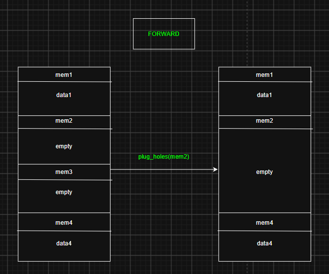
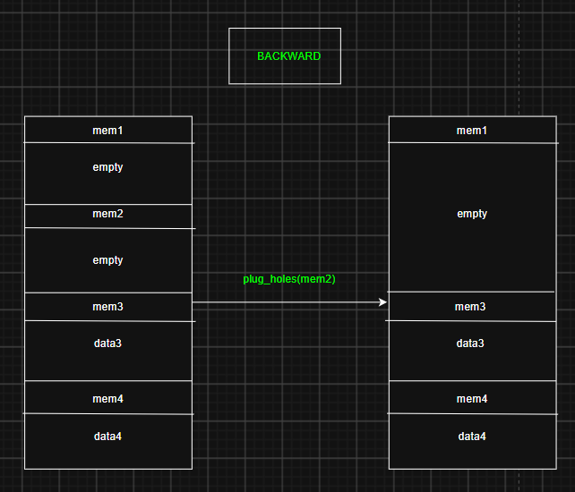

# 内存管理：RT-Thread 怎么用一条链表管住整个堆

> 环境：STM32F103C8T6（20KB SRAM）+ RT-Thread 4.0.3
> 源码：`rt-thread/src/mem.c`（`RT_USING_SMALL_MEM` 这一套），堆的交给它在 `drivers/board.c`
> 文中代码取自本工程实际使用的内核源码，不是照抄手册。

## 目录

- [先看结论](#overview)
- [Step 1 堆在哪儿：20KB SRAM 的切法](#step1)
- [Step 2 一块内存长什么样](#step2)
  - [① 块头 heap_mem](#step2-1)
  - [② 三个全局指针](#step2-2)
  - [③ 初始化后的链表](#step2-3)
- [Step 3 分配：rt_malloc](#step3)
  - [① 先对齐、再上锁](#step3-1)
  - [② 从 lfree 出发遍历](#step3-2)
  - [③ 两种分配策略：切分 / 整块给出](#step3-3)
  - [④ 分配以后 lfree 只会往前走](#step3-4)
- [Step 4 释放：rt_free](#step4)
  - [① 用数据指针减出块头](#step4-1)
  - [② "释放"不是归还](#step4-2)
  - [③ 校验为什么有两套](#step4-3)
- [Step 5 合并：plug_holes](#step5)
  - [① 前向合并（向高地址）](#step5-1)
  - [② 后向合并（向低地址）](#step5-2)
  - [③ 两边都空闲时会怎样](#step5-3)
- [总结：四个容易记错的点](#summary)
- [怎么自己验证](#verify)

---

`rt_malloc` / `rt_free` 用起来像魔法：随便要一块、随便还一块，不用管放哪。拆开看其实只有三件事：

1. 每块内存前面挂一个**块头**，记录它多大、有没有被用；
2. 所有块串成一条**双向链表**，指针字段存的是"相对堆起点的偏移"，不是绝对地址；
3. 分配 = 找一个够大的空闲块切开；释放 = 把标志位改回去 + 相邻空闲块合并。

一句话版本：

```
heap_ptr ─┬─ [块头][数据] ─┬─ [块头][空闲] ─┬─ … ─┬─ [哨兵]
          │   used=1       │   used=0       │      │  used=1（永不分配）
          └──── next / prev 都是相对 heap_ptr 的偏移 ────┘

rt_malloc : 从 lfree 开始顺着 next 找空闲块 → 够大就切一刀，余量不够就整块给出
rt_free   : 数据指针减 12 得到块头 → used 1 改 0 → plug_holes 合并左右空闲块
```

---

<a id="step1"></a>
## Step 1 堆在哪儿：20KB SRAM 的切法

`drivers/board.c` 里只有一句：

```c
rt_system_heap_init((void *) HEAP_BEGIN, (void *) HEAP_END);
```

而 `drivers/include/drv_common.h` 把这两个宏定成：

```c
#define HEAP_BEGIN      ((void *)&__bss_end)      /* GCC 分支 */
#define HEAP_END        STM32_SRAM1_END           /* 0x20005000 */
```

也就是说：**`.bss` 结束的地方就是堆开始的地方，RAM 顶就是堆结束的地方**。

```
0x20000000 ┌───────────────────────────────┐
           │ .data        1104 B (0x450)   │  ← 有初值的全局/静态变量
0x20000450 ├───────────────────────────────┤
           │ .stack       1024 B (0x400)   │  ← 系统栈（MSP）
0x20000850 ├───────────────────────────────┤
           │ .bss         5428 B (0x1534)  │  ← 未初始化的全局/静态变量
0x20001D84 ├───────────────────────────────┤  ← __bss_end = HEAP_BEGIN
           │ heap        12924 B (0x327C)  │  ← 动态分配区
0x20005000 └───────────────────────────────┘  ← HEAP_END = RAM 顶
```

由此可以直接推出两条：

- **静态变量多一寸，堆就少一寸**。加一个 `static char buf[100]`，堆的起点就往后挪 100。
- 堆里有两块 12 字节是**永久开销**：第一块的块头 + 尾部哨兵的块头。所以真正能被分配的只有

```c
mem_size_aligned = end_align - begin_align - 2 * SIZEOF_STRUCT_MEM;
                 = 12924 - 24 = 12900;
```

> 这里的具体地址取自本文写作时的一次构建。工程里加了组件（FlashDB、cJSON 之类）以后 `.bss` 会变大，堆起点随之后移、可用空间变短——算法不变，数字会变。自己查的办法在最后一节。

<a id="step2"></a>
## Step 2 一块内存长什么样

<a id="step2-1"></a>
### ① 块头 heap_mem

```c
#define HEAP_MAGIC 0x1ea0      /* 堆内存标志 */
#define SIZEOF_STRUCT_MEM  RT_ALIGN(sizeof(struct heap_mem), RT_ALIGN_SIZE)   /* 12 */

struct heap_mem
{
    rt_uint16_t magic;         /* 校验：这块是不是本堆的块 */
    rt_uint16_t used;          /* 0 空闲 / 1 已使用 */
    rt_size_t   next, prev;    /* 偏移量，不是指针 */
};
```

| 成员 | 含义 |
|---|---|
| `magic` | 校验标记，`free` 时用来判断这个块头是不是被踩过 |
| `used` | 唯一的状态位：0 空闲、1 已用。**"分配"和"释放"改的就是它** |
| `next` | 下一块**块头**相对 `heap_ptr` 的偏移量 |
| `prev` | 上一块**块头**相对 `heap_ptr` 的偏移量 |

两个容易读错的地方：

- **不是"自身到 heap_ptr 的偏移"**。`next` 记的是你身后那块的块头在哪，两个块头之间的距离才是数据区。
- **是偏移不是指针**（`rt_size_t`，4 字节）。取值要 `&heap_ptr[next]` 才能当真指针用。好处是堆整体搬家时不用遍历改值；代价是每次访问多一步加法。

于是"某块的数据区有多大"这个最常用的计算，写成：

```c
mem->next - (ptr + SIZEOF_STRUCT_MEM)
```

即：**下一块的起点 − 本块数据区的起点**。

<a id="step2-2"></a>
### ② 三个全局指针

```c
static rt_uint8_t *heap_ptr;              /* 堆起始地址 */
static struct heap_mem *lfree;            /* 最低的空闲块，malloc 从这里起步 */
static struct heap_mem *heap_end;         /* 尾哨兵 */
static struct rt_semaphore heap_sem;      /* 保护整个堆的二元信号量 */
static rt_size_t mem_size_aligned;        /* 可分配的总字节数 */
```

`lfree` 是整个算法的效率来源：不从堆头扫，从"最有希望的位置"扫。

<a id="step2-3"></a>
### ③ 初始化后的链表

```c
/* 第一块：整块堆先当成一个大空闲块 */
mem        = (struct heap_mem *)heap_ptr;
mem->magic = HEAP_MAGIC;
mem->next  = mem_size_aligned + SIZEOF_STRUCT_MEM;   /* 指向哨兵 */
mem->prev  = 0;                                     /* 指向自己：自己的偏移就是 0 */
mem->used  = 0;

/* 尾哨兵：占一个块头的位置，永远"已使用" */
heap_end        = (struct heap_mem *)&heap_ptr[mem->next];
heap_end->magic = HEAP_MAGIC;
heap_end->used  = 1;
heap_end->next  = mem_size_aligned + SIZEOF_STRUCT_MEM;   /* 指向自己 */
heap_end->prev  = mem_size_aligned + SIZEOF_STRUCT_MEM;   /* 指向自己 */

lfree = (struct heap_mem *)heap_ptr;
```

三个值得注意的点：

1. **哨兵的 `next` 指向自己**，不是指回第一块。所以这条链**不是环形链表**（别和 `rt_list` 搞混），而是一条从"第一块"到"哨兵"的线性双向链，两端各自自环：
   - 往前走：`第一块 → … → 哨兵 → 哨兵 → …`
   - 往回走：`… → 第一块(prev=0，也是自己) → 第一块`
2. **哨兵的 `used` 永远是 1**，所以分配循环永远不会选中它。所有遍历都必须自己判断终点（`!= heap_end` 或 `ptr < ...`）。
3. **哨兵的 `prev` 是死数据**：`split` 里本来就跳过它不写，`plug_holes` 里可能会写，但**没有任何代码去读哨兵的 prev**——因为往回走到了第一块就停了。

最后还初始化了一把锁：

```c
rt_sem_init(&heap_sem, "heap", 1, RT_IPC_FLAG_FIFO);
```

注意这是**二元信号量**，不是互斥量：没有优先级继承、没有 owner。低优先级线程正在 malloc 时，高优先级线程来要内存只能干等。窗口很短（链表操作，微秒级），一般可接受——但"二值信号量 ≠ 锁"这条老账在这里又一次成立。

<a id="step3"></a>
## Step 3 分配：rt_malloc

完整源码：

<details>
<summary>源码：rt_malloc(rt_size_t size)</summary>

```c
void *rt_malloc(rt_size_t size)
{
    rt_size_t ptr, ptr2;
    struct heap_mem *mem, *mem2;

    if (size == 0)
        return RT_NULL;

    RT_DEBUG_NOT_IN_INTERRUPT;

    size = RT_ALIGN(size, RT_ALIGN_SIZE);

    if (size > mem_size_aligned)
        return RT_NULL;

    /* every data block must be at least MIN_SIZE_ALIGNED long */
    if (size < MIN_SIZE_ALIGNED)
        size = MIN_SIZE_ALIGNED;

    /* take memory semaphore */
    rt_sem_take(&heap_sem, RT_WAITING_FOREVER);

    for (ptr = (rt_uint8_t *)lfree - heap_ptr;
         ptr < mem_size_aligned - size;
         ptr = ((struct heap_mem *)&heap_ptr[ptr])->next)
    {
        mem = (struct heap_mem *)&heap_ptr[ptr];

        if ((!mem->used) && (mem->next - (ptr + SIZEOF_STRUCT_MEM)) >= size)
        {
            if (mem->next - (ptr + SIZEOF_STRUCT_MEM) >=
                (size + SIZEOF_STRUCT_MEM + MIN_SIZE_ALIGNED))
            {
                /* 策略 1：切分——把剩下的大块单独做成一个空闲块 */
                ptr2 = ptr + SIZEOF_STRUCT_MEM + size;

                mem2        = (struct heap_mem *)&heap_ptr[ptr2];
                mem2->magic = HEAP_MAGIC;
                mem2->used  = 0;
                mem2->next  = mem->next;
                mem2->prev  = ptr;

                mem->next = ptr2;
                mem->used = 1;

                if (mem2->next != mem_size_aligned + SIZEOF_STRUCT_MEM)
                {
                    ((struct heap_mem *)&heap_ptr[mem2->next])->prev = ptr2;
                }
            }
            else
            {
                /* 策略 2：整块给出——余量不够再切一个块头出来 */
                mem->used = 1;
            }
            /* set memory block magic */
            mem->magic = HEAP_MAGIC;

            if (mem == lfree)
            {
                /* Find next free block after mem and update lowest free pointer */
                while (lfree->used && lfree != heap_end)
                    lfree = (struct heap_mem *)&heap_ptr[lfree->next];

                RT_ASSERT(((lfree == heap_end) || (!lfree->used)));
            }

            rt_sem_release(&heap_sem);

            /* return the memory data except mem struct */
            return (rt_uint8_t *)mem + SIZEOF_STRUCT_MEM;
        }
    }

    rt_sem_release(&heap_sem);

    return RT_NULL;
}
```

（`RT_MEM_STATS` 的记账和 `RT_USING_MEMTRACE` 的命名为了看清主干暂时省略，源码里都在。）
</details>

<a id="step3-1"></a>
### ① 先对齐、再上锁

```c
if (size == 0)               return RT_NULL;
RT_DEBUG_NOT_IN_INTERRUPT;   /* 中断里不能 malloc */
size = RT_ALIGN(size, RT_ALIGN_SIZE);        /* 4 字节对齐 */
if (size > mem_size_aligned) return RT_NULL;
if (size < MIN_SIZE_ALIGNED) size = MIN_SIZE_ALIGNED;   /* 至少 12 */
rt_sem_take(&heap_sem, RT_WAITING_FOREVER);
```

所以"申请 100 字节"实际占的是 **100 + 12 = 112** 字节：100 对齐到 4 还是 100，再加块头。这也是为什么 `free` 里 `used` 的增量总是 `size + SIZEOF_STRUCT_MEM`。

锁只在**真正开始动链表**之前才拿：前面的对齐、越界判断都是纯计算，不碰共享数据。

<a id="step3-2"></a>
### ② 从 lfree 出发遍历

```c
for (ptr = (rt_uint8_t *)lfree - heap_ptr;
     ptr < mem_size_aligned - size;
     ptr = ((struct heap_mem *)&heap_ptr[ptr])->next)
{
    mem = (struct heap_mem *)&heap_ptr[ptr];

    if ((!mem->used) && (mem->next - (ptr + SIZEOF_STRUCT_MEM)) >= size)
```

三句话读明白：

- **起点是 `lfree`**，不是 `heap_ptr`。比 `lfree` 更低的块要么已被占用，要么已经是空闲块（那 `lfree` 就该指向它）。
- **够不够大**的判断就是上一节那个公式：`mem->next - (ptr + 12) >= size`。
- **循环上限 `ptr < mem_size_aligned - size`**：这样指针永远不会走到哨兵之后，也就不用单独判"是不是哨兵"。

<a id="step3-3"></a>
### ③ 两种分配策略：切分 / 整块给出

**切分**——余量够放下"一个块头 + 最小数据"时：

```c
ptr2 = ptr + SIZEOF_STRUCT_MEM + size;      /* 新块头的位置 */

mem2        = (struct heap_mem *)&heap_ptr[ptr2];
mem2->magic = HEAP_MAGIC;
mem2->used  = 0;
mem2->next  = mem->next;                    /* 继承老块的后继 */
mem2->prev  = ptr;

mem->next = ptr2;
mem->used = 1;

if (mem2->next != mem_size_aligned + SIZEOF_STRUCT_MEM)
    ((struct heap_mem *)&heap_ptr[mem2->next])->prev = ptr2;
```

四步：算位置 → 造新块头 → 老块接上 → **修后继的 prev**。

最后那个 `if` 是关键：被切的是"最后一块"时，老块的 `next` 指向哨兵；如果照直改，改的就是**哨兵的 prev**。哨兵是链条的固定终点、它的 prev 没人读，所以这里干脆跳过不写。

```
切分前：
   ptr                     N（下一块）
    ↓                       ↓
   [mem 头][      空闲数据      ][X 头] → …

切分后：
   ptr        ptr2         N
    ↓          ↓           ↓
   [mem 头][数据][mem2 头][空闲][X 头] → …
                  ↑                 ↑
            新块头 prev=ptr    X->prev 要从 ptr 改成 ptr2
```

**整块给出**——余量太小时：

```c
else
{
    mem->used = 1;
}
```

判据是 `余量 < size + 12 + 12`。为什么不分？因为切完剩下的地方**连"一个块头 + 至少 12 字节数据"都放不下**，这个新块永远不可能被分配出去，切了只是白添一个块头。

源码注释把这件事说得更直接：

```c
/* mem->next will always be used at this point: if not we have 2 unused
 * structs in a row, plug_holes should have take care of this */
```

也就是：下一块一定是"已用"的——如果它空闲，`plug_holes` 在释放时就合并了，不可能出现两块连着空闲。所以**整块给出不是"内存紧张时才用"**，它跟全局还剩多少无关，只看当前这一块的余量。

<a id="step3-4"></a>
### ④ 分配以后 lfree 只会往前走

```c
if (mem == lfree)
{
    while (lfree->used && lfree != heap_end)
        lfree = (struct heap_mem *)&heap_ptr[lfree->next];

    RT_ASSERT(((lfree == heap_end) || (!lfree->used)));
}
```

拿走的正好是 `lfree` 时，顺着 `next` 找下一个空闲块；一个都没有就停在 `heap_end`。注意 `lfree` 的语义只是"**从这往后**第一个空闲块"，它可以是 `heap_end`（表示后面全是已用）。

<a id="step4"></a>
## Step 4 释放：rt_free

完整源码：

<details>
<summary>源码：rt_free(void *rmem)</summary>

```c
void rt_free(void *rmem)
{
    struct heap_mem *mem;

    if (rmem == RT_NULL)
        return;

    RT_DEBUG_NOT_IN_INTERRUPT;

    RT_ASSERT((((rt_ubase_t)rmem) & (RT_ALIGN_SIZE - 1)) == 0);
    RT_ASSERT((rt_uint8_t *)rmem >= (rt_uint8_t *)heap_ptr &&
              (rt_uint8_t *)rmem < (rt_uint8_t *)heap_end);

    if ((rt_uint8_t *)rmem < (rt_uint8_t *)heap_ptr ||
        (rt_uint8_t *)rmem >= (rt_uint8_t *)heap_end)
    {
        RT_DEBUG_LOG(RT_DEBUG_MEM, ("illegal memory\n"));
        return;
    }

    /* Get the corresponding struct heap_mem ... */
    mem = (struct heap_mem *)((rt_uint8_t *)rmem - SIZEOF_STRUCT_MEM);

    rt_sem_take(&heap_sem, RT_WAITING_FOREVER);

    if (!mem->used || mem->magic != HEAP_MAGIC)
    {
        rt_kprintf("to free a bad data block:\n");
        rt_kprintf("mem: 0x%08x, used flag: %d, magic code: 0x%04x\n",
                   mem, mem->used, mem->magic);
    }
    RT_ASSERT(mem->used);
    RT_ASSERT(mem->magic == HEAP_MAGIC);

    /* ... and is now unused. */
    mem->used  = 0;
    mem->magic = HEAP_MAGIC;

    if (mem < lfree)
        lfree = mem;

    used_mem -= (mem->next - ((rt_uint8_t *)mem - heap_ptr));

    plug_holes(mem);

    rt_sem_release(&heap_sem);
}
```
</details>

<a id="step4-1"></a>
### ① 用数据指针减出块头

```c
mem = (struct heap_mem *)((rt_uint8_t *)rmem - SIZEOF_STRUCT_MEM);
```

`rt_free` 收到的是 `rt_malloc` 返回的**数据指针**，块头就在它前面 12 字节。不用查表、不用记录分配历史，纯粹靠布局反推——这一步和 `container_of` 是同一个思路：**知道成员在哪，就能算出结构体在哪**。

<a id="step4-2"></a>
### ② "释放"不是归还

```c
mem->used  = 0;
mem->magic = HEAP_MAGIC;
```

整个 `rt_free` 里**没有一行是清数据的**。所以：

- 释放之后再读那块内存，读到的还是旧值；
- 这正是 use-after-free "看起来一切正常"的原因，也是悬空指针最阴的地方；
- 但那份数据随时会被下一次 `rt_malloc` 覆写，**任何依赖它的写法都是错的**。

接着两句维护索引：

```c
if (mem < lfree)
    lfree = mem;                     /* 空闲块更靠前了，lfree 往回退 */

used_mem -= (mem->next - ((rt_uint8_t *)mem - heap_ptr));   /* 减掉整块：块头 + 数据 */
```

`lfree` 在 `rt_malloc` 里只会往前推，在这里可能往回退——两边合起来才保证"`lfree` 永远指向最低的空闲块"。

<a id="step4-3"></a>
### ③ 校验为什么有两套

```c
RT_ASSERT((((rt_ubase_t)rmem) & (RT_ALIGN_SIZE - 1)) == 0);       /* 调试期 */
RT_ASSERT((rt_uint8_t *)rmem >= heap_ptr && rmem < heap_end);

if ((rt_uint8_t *)rmem < heap_ptr || (rt_uint8_t *)rmem >= heap_end)   /* 运行期 */
{
    return;                                                       /* 只打印日志 */
}
...
RT_ASSERT(mem->used);
RT_ASSERT(mem->magic == HEAP_MAGIC);
```

`RT_ASSERT` 展开成什么取决于 `RT_DEBUG`（本工程 `rtconfig.h` 里是开的）；**关掉以后 assert 全部消失，只剩那个 `if`**。所以发布版里：

- 指向堆**外面**的指针 → 被 `if` 拦住，安全返回；
- 指向堆**里面**、但从来没分配过的地址 → 拦不住，会拿一块随机内存当块头改，**静默破坏数据**；
- 重复 `free` 同一块 → 调试期被 `!mem->used` 的 assert 当场抓住；发布期则会静默把这块并进链表两次。

最后一行 `if (!mem->used || magic != HEAP_MAGIC)` 只是**打印**（方便你看到是哪个地址烂了），拦住它的是后面的 `RT_ASSERT`。

<a id="step5"></a>
## Step 5 合并：plug_holes

<details>
<summary>源码：plug_holes(struct heap_mem *mem)</summary>

```c
static void plug_holes(struct heap_mem *mem)
{
    struct heap_mem *nmem;
    struct heap_mem *pmem;

    RT_ASSERT((rt_uint8_t *)mem >= heap_ptr);
    RT_ASSERT((rt_uint8_t *)mem < (rt_uint8_t *)heap_end);
    RT_ASSERT(mem->used == 0);

    /* plug hole forward */
    nmem = (struct heap_mem *)&heap_ptr[mem->next];
    if (mem != nmem &&
        nmem->used == 0 &&
        (rt_uint8_t *)nmem != (rt_uint8_t *)heap_end)
    {
        /* if mem->next is unused and not end of heap_ptr,
         * combine mem and mem->next
         */
        if (lfree == nmem)
            lfree = mem;

        mem->next = nmem->next;
        ((struct heap_mem *)&heap_ptr[nmem->next])->prev = (rt_uint8_t *)mem - heap_ptr;
    }

    /* plug hole backward */
    pmem = (struct heap_mem *)&heap_ptr[mem->prev];
    if (pmem != mem && pmem->used == 0)
    {
        /* if mem->prev is unused, combine mem and mem->prev */
        if (lfree == mem)
            lfree = pmem;

        pmem->next = mem->next;
        ((struct heap_mem *)&heap_ptr[mem->next])->prev = (rt_uint8_t *)pmem - heap_ptr;
    }
}
```
</details>

`plug_holes` 只在释放时被调用，做一件事：**把 freeing 的块和左右相邻的空闲块并起来**，让块头数量变少、连续空闲区变长。

先统一两个方向词，免得读到一半反过来：

- **前向（forward）** = 向**高地址**，即 `mem->next` 那块；
- **后向（backward）** = 向**低地址**，即 `mem->prev` 那块。

链表文章里 forward/backward 常常是反过来的，读代码时以 `nmem/mem->next`（高）和 `pmem/mem->prev`（低）为准。

<a id="step5-1"></a>
### ① 前向合并（向高地址）

```c
nmem = (struct heap_mem *)&heap_ptr[mem->next];
if (mem != nmem && nmem->used == 0 && (rt_uint8_t *)nmem != (rt_uint8_t *)heap_end)
{
    if (lfree == nmem)
        lfree = mem;

    mem->next = nmem->next;
    ((struct heap_mem *)&heap_ptr[nmem->next])->prev = (rt_uint8_t *)mem - heap_ptr;
}
```

三个条件，各防一件事：

| 条件 | 防的是 |
|---|---|
| `mem != nmem` | 这已经是最后一个块（`next` 指回自己） |
| `nmem->used == 0` | 下一块正在使用，不能并 |
| `nmem != heap_end` | 下一块是哨兵，哨兵不可并、也不能改 |

动作只有两句：`mem` 的 `next` 跨过 `nmem`，直接接到 `nmem` 的下一块；那下一块的 `prev` 改回 `mem`。**`nmem` 的块头就此失效**——不是清零，是被圈进 `mem` 的数据区里。

如果被吞掉的 `nmem` 正好是 `lfree`，最低空闲块就变成了 `mem`。



读图：`mem2` 释放后，它的下一块 `mem3` 也空闲 → `mem2` 直接跨过 `mem3`（连同 `mem3` 的块头）接到 `mem4`。

<a id="step5-2"></a>
### ② 后向合并（向低地址）

```c
pmem = (struct heap_mem *)&heap_ptr[mem->prev];
if (pmem != mem && pmem->used == 0)
{
    if (lfree == mem)
        lfree = pmem;

    pmem->next = mem->next;
    ((struct heap_mem *)&heap_ptr[mem->next])->prev = (rt_uint8_t *)pmem - heap_ptr;
}
```

这里只有两个条件，因为另外两条天然成立：

- **不用判哨兵**：哨兵的 `used` 恒为 1，永远进不来；
- **不用判"有没有前一块"**：`prev` 一定有效（第一块的 `prev=0` 指向自己，而 `pmem != mem` 正好把这种情况挡掉）。

动作是镜像的：`pmem` 的 `next` 接到 `mem` 的下一块；`mem` 的下一块 `prev` 改回 `pmem`。这次失效的块头是 `mem` 自己。



读图：`mem2` 释放后，它的前一块 `mem1` 也空闲 → `mem1` 向后吞掉 `mem2`（`mem2` 的块头消失），`mem1` 的 `next` 接到 `mem3`。

<a id="step5-3"></a>
### ③ 两边都空闲时会怎样

代码是**先 forward 再 backward**，顺序不能换着理解：先往高地址吞一个，再被低地址吞掉。三块连着空闲时：

```
释放前：  [A 头][空闲][B 头][空闲][C 头][数据] … [哨兵]

free(B)，forward：B 吞掉 C
          [A 头][空闲][B 头][     空闲      ][哨兵]

           backward：A 吞掉 B
          [A 头][          空闲（三块合一）          ][哨兵]
```

最终只剩最前面那个块头。也正因为释放时都会合并，`rt_malloc` 里才敢断言"下一块一定在使用"。

另外注意：**分配时从不合并，只切分**。碎片是"释放时顺手收拾"的，不是"分配时找补"的。

---

<a id="summary"></a>
## 总结：四个容易记错的点

1. **`next` / `prev` 是偏移不是指针，而且存的是"块头的位置"**——不是"本块数据区的偏移"。第一块 `prev=0`、哨兵 `next=prev=自己`，两头各自自环，所以这**不是环形链表**。
2. **`free` 不是归还**——只是把 `used` 从 1 改成 0，数据一个字节都没动。use-after-free 能"读回旧值"，但那块随时会被下一次 malloc 覆写。
3. **切不切块看的是余量，不是全局剩余**——余量要能放下"一个块头(12) + 最小数据(12)"才切，否则整块给出。判据跟堆整体还剩多少无关。
4. **合并先向高地址、再向低地址**——两边都空闲时，先吞后继、再被前驱吞，最后只留最前面那个块头。

<a id="verify"></a>
## 怎么自己验证

- **核对堆起点**：`arm-none-eabi-nm Debug/rtthread.elf | grep -E "__bss_end|_ebss"`，应该等于 `heap_ptr`；堆大小 = `0x20005000 - __bss_end`。
- **核对可用总量**：串口敲 `free`（或调 `list_mem()` / `rt_memory_info()`），`total` 应该正好是 `堆大小 - 24`。
- **看切分**：申请 100 字节，`used` 应该 +112；连着申请三块，返回地址的步长是 0x70（112）。
- **看 lfree 回退**：释放中间那块，再申请同样大小的块，地址会原样回到刚才那块——这就是 `lfree` 退回去、首次适配命中的现场。
- **看合并**：申请 A、B、C 三块，先释放 B，再释放 A，然后申请一大块——如果 A+B+C 的总量够，说明三次释放后它们被并成了一整块。
- **看 max_mem**：`free` 里的 `max` 只涨不跌，是历史水位；`used` 才是当前存量。两个数一起看才能判断有没有泄漏。

> 文中地址来自一次具体构建。工程里加组件之后，`.bss` 会变大、堆起点后移、可用空间变短——数字对不上时，先按上面第一条重新查一遍 `__bss_end`，别怀疑算法。
