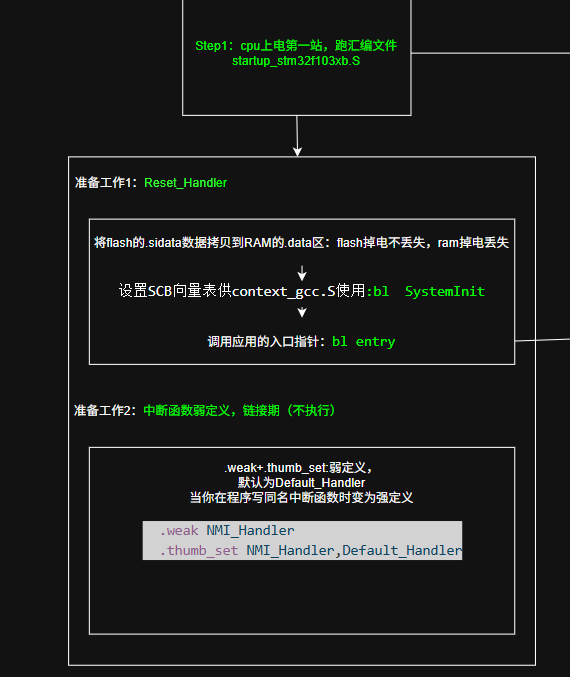
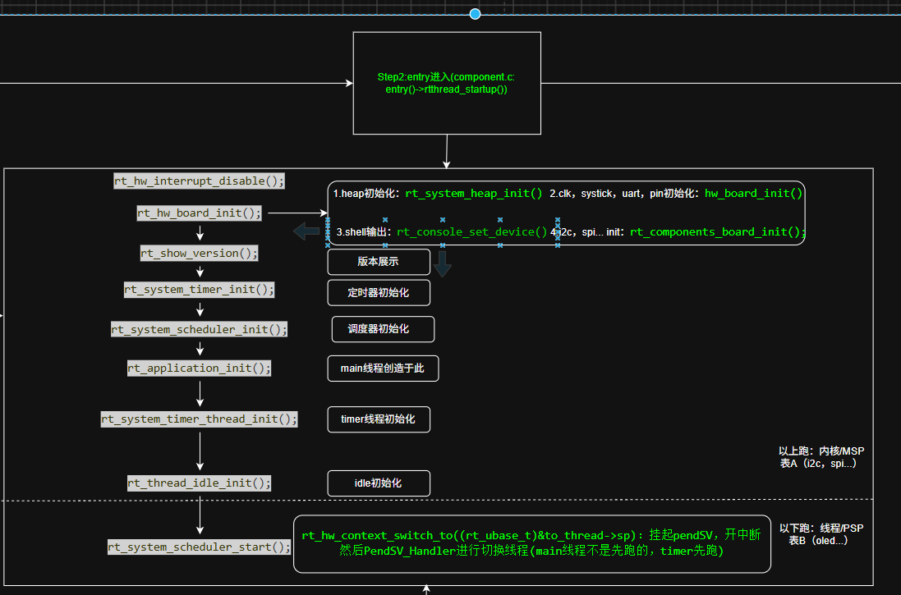
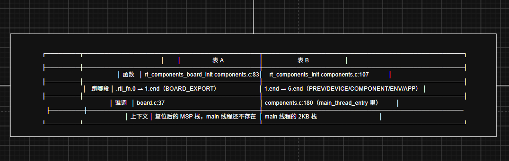
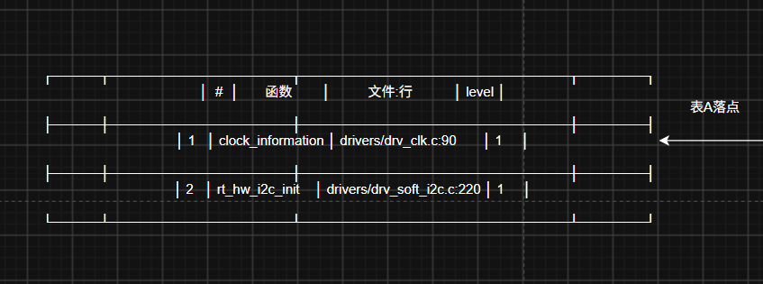
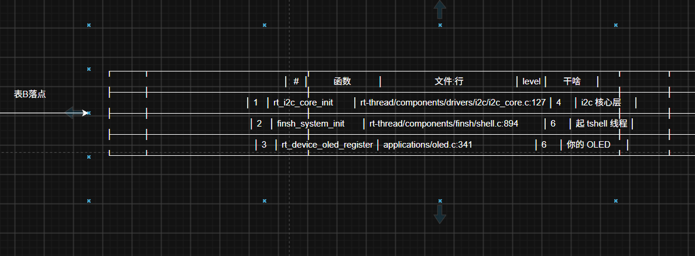
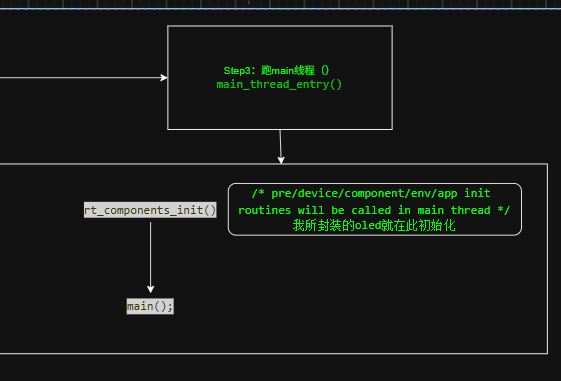

### 启动链路 ###
目录：
- [Step1](#Step1)
- [Step2](#Step2)
- [Step3](#Step3)

### Step1 ###
跑汇编文件：startup_stm32f103xb.S

### Reset Handler ###

① 复制 .data（Flash → SRAM）:
### 说明：Flash掉电不丢失，SRAM掉电丢失。每次上电时，都需要将Flash中的数据复制到SRAM中，才能正常运行。(.data：存放有初始值的全局，静态变量)
<details>
<summary>源码：flash → sram</summary>

``` assembly
/* Copy the data segment initializers from flash to SRAM */
  movs r1, #0
  b LoopCopyDataInit

CopyDataInit:
  ldr r3, =_sidata
  ldr r3, [r3, r1]
  str r3, [r0, r1]
  adds r1, r1, #4

LoopCopyDataInit:
  ldr r0, =_sdata
  ldr r3, =_edata
  adds r2, r0, r1
  cmp r2, r3
  bcc CopyDataInit
  ldr r2, =_sbss
  b LoopFillZerobss
```
</details>

② 清零 .bss
### 说明：.bss：存放未初始化的全局，静态变量。
### 每次上电时，都需要将.bss中的数据清零，所以说未初始化的变量默认值为0。
<details>
<summary>源码：bss清零</summary>

``` assembly
/* Zero fill the bss segment. */
FillZerobss:
  movs r3, #0
  str r3, [r2], #4

LoopFillZerobss:
  ldr r3, = _ebss
  cmp r2, r3
  bcc FillZerobss
```
</details>

③ 时钟/系统初始化
### 说明：时钟/系统初始化是系统启动时，必须进行的操作。
### 这一步进行了时钟的配置，以及设置了SCB->VTOR（中断向量表地址）,存放在flash起始地址，里边存放的是中断函数的地址（像Reset Handler，NMI Handler，Hard Fault Handler等）。
<details>
<summary>源码：时钟/系统初始化</summary>

``` assembly
/* Call the clock system intitialization function.*/
    bl  SystemInit
```

---->跳转到SystemInit函数

```c
void SystemInit (void)
{
  /* Reset the RCC clock configuration to the default reset state(for debug purpose) */
  /* Set HSION bit */
  RCC->CR |= 0x00000001U;

  /* Reset SW, HPRE, PPRE1, PPRE2, ADCPRE and MCO bits */
#if !defined(STM32F105xC) && !defined(STM32F107xC)
  RCC->CFGR &= 0xF8FF0000U;
#else
  RCC->CFGR &= 0xF0FF0000U;
#endif /* STM32F105xC */   
  
  /* Reset HSEON, CSSON and PLLON bits */
  RCC->CR &= 0xFEF6FFFFU;

  /* Reset HSEBYP bit */
  RCC->CR &= 0xFFFBFFFFU;

  /* Reset PLLSRC, PLLXTPRE, PLLMUL and USBPRE/OTGFSPRE bits */
  RCC->CFGR &= 0xFF80FFFFU;

#if defined(STM32F105xC) || defined(STM32F107xC)
  /* Reset PLL2ON and PLL3ON bits */
  RCC->CR &= 0xEBFFFFFFU;

  /* Disable all interrupts and clear pending bits  */
  RCC->CIR = 0x00FF0000U;

  /* Reset CFGR2 register */
  RCC->CFGR2 = 0x00000000U;
#elif defined(STM32F100xB) || defined(STM32F100xE)
  /* Disable all interrupts and clear pending bits  */
  RCC->CIR = 0x009F0000U;

  /* Reset CFGR2 register */
  RCC->CFGR2 = 0x00000000U;      
#else
  /* Disable all interrupts and clear pending bits  */
  RCC->CIR = 0x009F0000U;
#endif /* STM32F105xC */
    
#if defined(STM32F100xE) || defined(STM32F101xE) || defined(STM32F101xG) || defined(STM32F103xE) || defined(STM32F103xG)
  #ifdef DATA_IN_ExtSRAM
    SystemInit_ExtMemCtl(); 
  #endif /* DATA_IN_ExtSRAM */
#endif 

#ifdef VECT_TAB_SRAM
  SCB->VTOR = SRAM_BASE | VECT_TAB_OFFSET; /* Vector Table Relocation in Internal SRAM. */
#else
  SCB->VTOR = FLASH_BASE | VECT_TAB_OFFSET; //(0x08000000UL)
  /* Vector Table Relocation in Internal FLASH. */
#endif 
}
```
</details>

④ 跳到 C 世界——但这里跳的是 entry，不是 main
### 说明: 这里跳的是 entry，不是 main，因为 entry 是系统启动时，第一个被调用的函数，而 main 是用户程序的入口函数。

<details>

<summary>源码：跳转到 entry</summary>

  ``` assembly
/* Call the application's entry point.*/
  bl  entry

  ---->跳转到entry函数

  ```

  ```c
int entry(void)
{
    rtthread_startup();
    return 0;
}
  ```
</details>

### 中断函数弱定义 ###
### 说明：链接期不执行。当用户程序中没有定义中断函数时，会使用默认的中断函数（开了中断，没写中断函数，会跑HardFault_Handler,循环卡死）。
<details>
<summary>源码：中断函数弱定义</summary>

``` assembly
  .weak NMI_Handler
  .thumb_set NMI_Handler,Default_Handler

  .weak HardFault_Handler
  .thumb_set HardFault_Handler,Default_Handler
  ........
  ........
```
</details>

### drawio 分析图:



### Step2 ###
正式进入c语言世界，接Step1的entry函数
### 说明：进行初始化操作
1. 调用rtthread_startup()函数
<details>
<summary>源码：rtthread_startup()函数</summary>

```c
int rtthread_startup(void)
{
    rt_hw_interrupt_disable();

    /* board level initialization
     * NOTE: please initialize heap inside board initialization.
     */
    rt_hw_board_init();

    /* show RT-Thread version */
    rt_show_version();

    /* timer system initialization */
    rt_system_timer_init();

    /* scheduler system initialization */
    rt_system_scheduler_init();

#ifdef RT_USING_SIGNALS
    /* signal system initialization */
    rt_system_signal_init();
#endif

    /* create main thread */
    rt_application_init();

    /* timer thread initialization */
    rt_system_timer_thread_init();

    /* idle thread initialization */
    rt_thread_idle_init();

#ifdef RT_USING_SMP
    rt_hw_spin_lock(&_cpus_lock);
#endif /*RT_USING_SMP*/

    /* start scheduler */
    rt_system_scheduler_start();

    /* never reach here */
    return 0;
}
```
</details>

### drawio 分析图1:


### drawio 分析图2:
 

### drawio 分析图3:
 

### drawio 分析图4:


### Step3 ###
跑 main 线程
### 说明：scheduler 启动后，开始跑 main 线程（不是第一个跑，第一个跑timer线程）
### 
<details>
<summary>源码：main 线程</summary>

```c
/* the system main thread */
void main_thread_entry(void *parameter)
{
    extern int main(void);
    extern int $Super$$main(void);

#ifdef RT_USING_COMPONENTS_INIT
    /* RT-Thread components initialization */
    rt_components_init(); //表B落点，封装的驱动在此初始化（例如tshell，自主封装的驱动）
#endif
#ifdef RT_USING_SMP
    rt_hw_secondary_cpu_up();
#endif
    /* invoke system main function */
#if defined(__CC_ARM) || defined(__CLANG_ARM)
    $Super$$main(); /* for ARMCC. */
#elif defined(__ICCARM__) || defined(__GNUC__)
    main();
#endif
}
```
</details>

### drawio 分析图:
