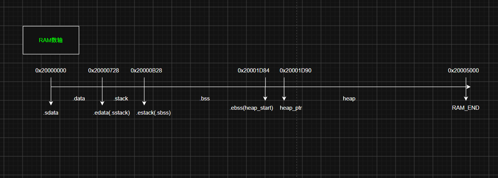

# 从 Reset_Handler 到 main：RT-Thread 在 STM32F103 上是怎么启动的

> 环境：STM32F103C8T6 + RT-Thread 4.0.3 + RT-Thread Studio 2.3.1（GCC）
> 文中代码均取自本工程实际构建，不是照抄手册。

## 目录

- [Step 1 汇编阶段：Reset_Handler](#step1)
  - [① 把 .data 从 Flash 搬到 SRAM](#step1-1)
  - [② 清零 .bss](#step1-2)
  - [③ SystemInit：复位时钟 + 设中断向量表](#step1-3)
  - [④ 进入 C 世界：跳的是 entry，不是 main](#step1-4)
  - [⑤ 中断函数的弱定义](#step1-5)
- [Step 2 进入 RT-Thread：rtthread_startup()](#step2)
- [Step 3 调度器启动后：谁先跑？](#step3)
- [一张数轴看内存怎么变](#mem)
- [总结：四个容易记错的点](#summary)
- [怎么自己验证](#verify)

---

很多人以为上电后就直接跑 `main` 了。其实在 RT-Thread 里，`main` 只是「main 线程」里的一个普通函数，它前面隔着两层：一层汇编、一层 C 初始化，最后还要等调度器启动。

把整条链拆成三段：

1. **Step 1 汇编阶段**：`Reset_Handler` 准备 C 运行环境 → 调 `SystemInit` → 跳 `entry`
2. **Step 2 C 初始化**：`entry → rtthread_startup()`，初始化内核、建线程
3. **Step 3 调度器启动**：`rt_system_scheduler_start()` 挑最高优先级线程先跑；`main` 在 main 线程里最后出场

一句话版本：

```
Reset_Handler
  → 搬 .data / 清 .bss
  → SystemInit（复位时钟、设中断向量表）
  → entry()
  → rtthread_startup()
      → rt_hw_board_init()          ← 72MHz 时钟和堆都在这里配
      → 定时器 / 调度器 / main 线程 / timer 线程 / idle 线程
  → rt_system_scheduler_start()
  → 优先级最高的就绪线程（默认是 timer 线程）
  → main_thread_entry() → rt_components_init() → main()
```

---

<a id="step1"></a>
## Step 1 汇编阶段：Reset_Handler

上电（或复位）后，CPU 从向量表第二项取出地址，跳到 `Reset_Handler`。

<a id="step1-1"></a>
### ① 把 .data 从 Flash 搬到 SRAM

`.data` 放的是**有初值的全局/静态变量**。初值存在 Flash（掉电不丢），但运行时变量得在 SRAM，所以每次上电都要搬一遍。

```assembly
/* Copy the data segment initializers from flash to SRAM */
  movs r1, #0
  b LoopCopyDataInit

CopyDataInit:
  ldr r3, =_sidata        /* 源：Flash 里存的初值 */
  ldr r3, [r3, r1]
  str r3, [r0, r1]        /* 目标：SRAM 里的 .data */
  adds r1, r1, #4

LoopCopyDataInit:
  ldr r0, =_sdata
  ldr r3, =_edata
  adds r2, r0, r1
  cmp r2, r3
  bcc CopyDataInit        /* 没到末尾就继续搬 */
```

`_sidata` 是初值在 Flash 里的位置，`_sdata` / `_edata` 是变量在 SRAM 里的位置——链接脚本用 LMA / VMA 分别描述这两套地址。

<a id="step1-2"></a>
### ② 清零 .bss

`.bss` 放**未初始化的全局/静态变量**。C 标准规定它们的初值为 0，所以上电清一次。

```assembly
/* Zero fill the bss segment. */
FillZerobss:
  movs r3, #0
  str r3, [r2], #4

LoopFillZerobss:
  ldr r3, = _ebss
  cmp r2, r3
  bcc FillZerobss
```

这一步也解释了为什么「未初始化变量默认是 0」——不是编译器的魔法，是启动代码替你还的债。

<a id="step1-3"></a>
### ③ SystemInit：复位时钟 + 设中断向量表

```assembly
/* Call the clock system intitialization function.*/
    bl  SystemInit
```

`SystemInit` 做两件事：

1. 把 RCC 打回**复位默认状态**（时钟源回到内部 HSI 8MHz）；
2. 设置 `SCB->VTOR = FLASH_BASE`（0x08000000），告诉内核中断向量表在哪。

```c
/* 节选：SystemInit 的关键动作 */
RCC->CR   |= 0x00000001U;   /* 先把 HSI 打开 */
RCC->CFGR &= 0xF8FF0000U;   /* 清 SW / HPRE / PPRE / ADCPRE / MCO */
...
SCB->VTOR = FLASH_BASE;     /* 向量表定位到 Flash 起始 */
```

**这里有个常见误解**：`SystemInit` 并没有把主频配到 72MHz，它只是**复位**。真正的 72MHz 在 Step 2 的 `rt_hw_board_init()` 里配置（见下文）。

> 完整函数见 STM32F1 标准外设库 `system_stm32f1xx.c`，本文只保留关键两段。

<a id="step1-4"></a>
### ④ 进入 C 世界：跳的是 entry，不是 main

```assembly
/* Call the application's entry point.*/
  bl  entry
```

`entry` 才是第一个 C 函数，它只有一句话：

```c
int entry(void)
{
    rtthread_startup();
    return 0;
}
```

注意：`main` 不在这里出场，`entry` 直接进 `rtthread_startup()`。

<a id="step1-5"></a>
### ⑤ 中断函数的弱定义

启动文件末尾给每个异常/中断都写了弱符号：

```assembly
  .weak NMI_Handler
  .thumb_set NMI_Handler,Default_Handler

  .weak HardFault_Handler
  .thumb_set HardFault_Handler,Default_Handler
  ......
```

含义：**链接期**，如果别处（比如你的驱动）有同名强定义，就用你的；没有，就把这个向量绑到默认处理函数 `Default_Handler`：

```assembly
Default_Handler:
Infinite_Loop:
  b Infinite_Loop        /* 原地死循环 */
```

所以「开了中断却没写处理函数」的后果是**落进 `Default_Handler` 死循环**，不是进 HardFault——HardFault 是另一种异常，只有真的出错（非法访问、取指错误等）才触发。

### Step 1 流程图


---

<a id="step2"></a>
## Step 2 进入 RT-Thread：rtthread_startup()

`entry` 调的就是它：

```c
int rtthread_startup(void)
{
    rt_hw_interrupt_disable();          /* 先关全局中断 */

    rt_hw_board_init();                 /* 板级初始化：堆 + 时钟 */
    rt_show_version();                  /* 打印版本 */

    rt_system_timer_init();             /* 软件定时器系统 */
    rt_system_scheduler_init();         /* 调度器 */

#ifdef RT_USING_SIGNALS
    rt_system_signal_init();
#endif

    rt_application_init();              /* 创建 main 线程 */
    rt_system_timer_thread_init();      /* 创建 timer 线程 */
    rt_thread_idle_init();              /* 创建 idle 线程 */

    rt_system_scheduler_start();        /* 启动调度器，永不返回 */
    return 0;
}
```

几个值得注意的点：

- **第一句就关中断**：后面全在初始化内核数据结构，不能被打断。
- **`rt_hw_board_init()` 才是真正配时钟的地方**：本工程实际调用是
  `hw_board_init(BSP_CLOCK_SOURCE, ..., BSP_CLOCK_SYSTEM_FREQ_MHZ)`，
  而 `board.h` 里写的是 `BSP_CLOCK_SOURCE = "HSI"`、`BSP_CLOCK_SYSTEM_FREQ_MHZ = 72`。
  堆也是在这里初始化的（`rt_system_heap_init`）——所以这之前不能用 `rt_malloc`。
- **`rt_application_init()` 只是「创建」main 线程，并不运行它**：线程创建后进就绪队列，等调度器开跑才轮到。
- **`rt_system_scheduler_start()` 不返回**，所以函数末尾的 `return 0` 永远走不到。

### Step 2 流程图


---

<a id="step3"></a>
## Step 3 调度器启动后：谁先跑？

`rt_system_scheduler_start()` 做的事很简单：**从就绪队列里挑优先级最高的线程切过去**。

本工程默认配置下，timer 线程优先级 4、main 线程 10、idle 线程 31，所以第一个跑的是 **timer 线程**，不是 main。但别把它当成固定顺序——本质是「优先级最高者先跑」，改了优先级或启动瞬间有更高优先级线程就绪，顺序就变。

main 线程的入口是 `main_thread_entry`：

```c
void main_thread_entry(void *parameter)
{
    extern int main(void);
    extern int $Super$$main(void);

#ifdef RT_USING_COMPONENTS_INIT
    rt_components_init();     /* 组件/驱动的自动初始化在这里集中执行 */
#endif

#if defined(__CC_ARM) || defined(__CLANG_ARM)
    $Super$$main();
#elif defined(__ICCARM__) || defined(__GNUC__)
    main();                   /* 直到这里，才真正调用你的 main */
#endif
}
```

所以 `main()` 的地位：它既不是复位入口，也不是启动函数，只是**被 main 线程调用的一个普通函数**。我们熟悉的 `INIT_DEVICE_EXPORT / INIT_COMPONENT_EXPORT / INIT_ENV_EXPORT / INIT_APP_EXPORT`，就是在 `rt_components_init()` 里按等级依次执行的（`INIT_BOARD_EXPORT` 那级更早，在 `rt_hw_board_init()` 里就跑过了）。

### Step 3 流程图


---

<a id="mem"></a>
## 一张数轴看内存怎么变



---

<a id="summary"></a>
## 总结：四个容易记错的点

1. **`main` 不是程序入口**——入口是 `Reset_Handler`，`main` 在 main 线程里。
2. **`SystemInit` 不配 72MHz**——它只复位时钟 + 设 VTOR，真正的主频在 `rt_hw_board_init()`。
3. **没写中断处理函数不会进 HardFault**——会落到 `Default_Handler` 死循环。
4. **调度器启动后第一个跑的不一定是 main**——谁优先级高谁先跑，默认是 timer 线程。

<a id="verify"></a>
## 怎么自己验证

- 在 `entry` / `rtthread_startup` / `main_thread_entry` 打断点，看调用栈是不是这条链；
- `arm-none-eabi-nm` 查 `_sidata / _sdata / _edata / _sbss / _ebss` 的地址，对照链接脚本；
- 把 main 线程优先级调到比 timer 高，重新跑，看谁先打印——第 4 条就现场验证了。

---

<details>
<summary>附：本工程的关键配置（rtconfig.h）</summary>

```c
#define RT_THREAD_PRIORITY_MAX      32
#define RT_TIMER_THREAD_PRIO        4
#define RT_MAIN_THREAD_PRIORITY     10
#define RT_USING_HEAP
#define RT_USING_COMPONENTS_INIT
```

</details>
